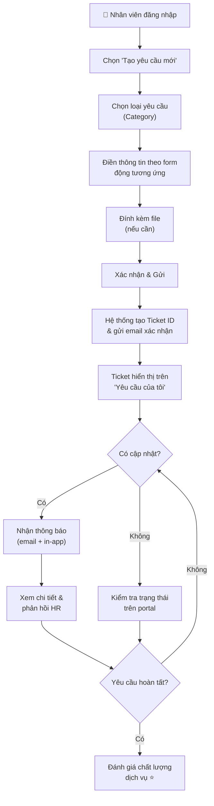
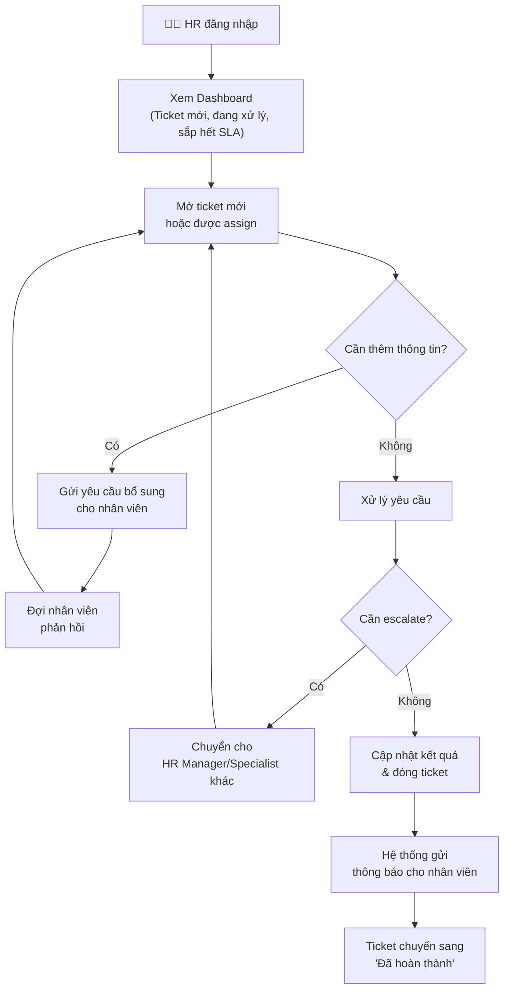
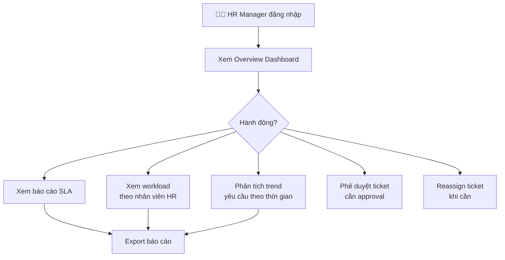
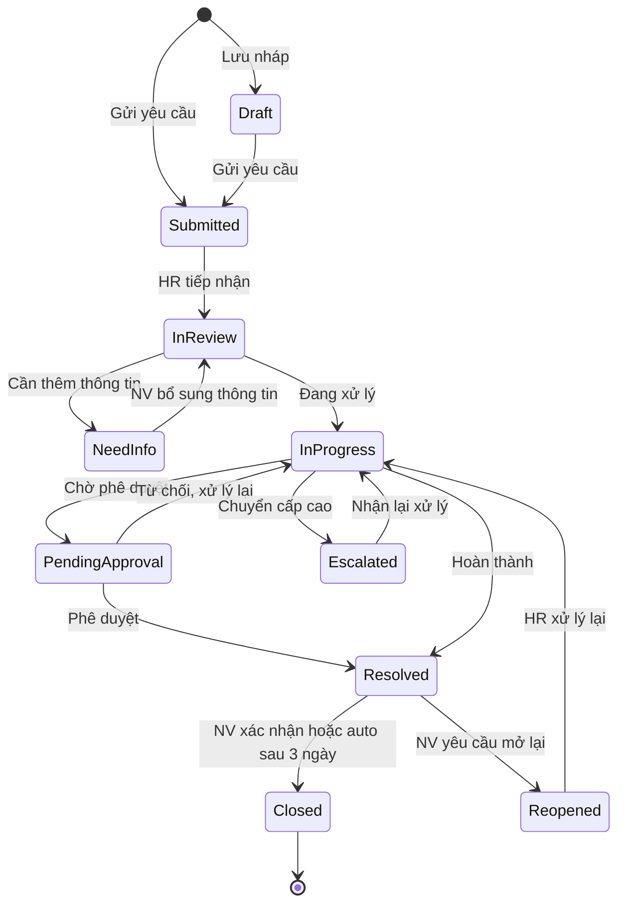
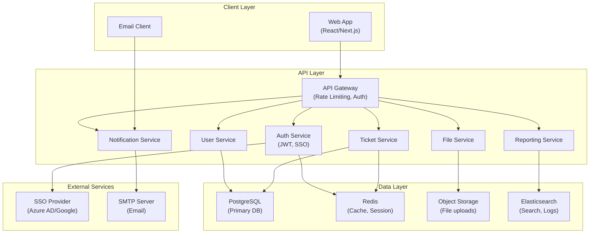
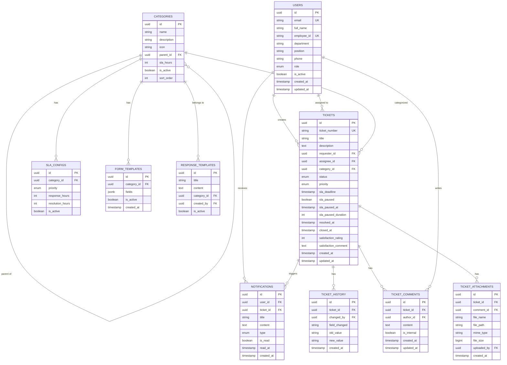
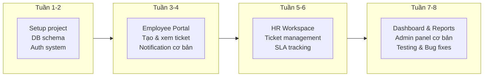

# 📋 PRD – HR Service Desk Web Application

> **Phiên bản:** 1.0  
> **Ngày tạo:** 09/10/2026  
> **Tác giả:** BA / Product Team  
> **Trạng thái:** Draft – Chờ review

---

## 1. Tổng quan sản phẩm (Product Overview)

### 1.1 Tên sản phẩm
**HR Service Desk** – Hệ thống quản lý yêu cầu nhân sự

### 1.2 Tầm nhìn sản phẩm (Product Vision)
Xây dựng một nền tảng web tập trung, minh bạch và hiệu quả để **nhân viên** gửi, theo dõi mọi yêu cầu liên quan đến HR, đồng thời giúp **bộ phận HR** tiếp nhận, xử lý, phân tích và tối ưu quy trình vận hành nhân sự.

### 1.3 Bối cảnh & Vấn đề (Problem Statement)

| # | Pain Point | Ảnh hưởng |
|---|-----------|-----------|
| 1 | Yêu cầu HR đến qua **nhiều kênh** (email, Teams, gặp trực tiếp) | Thông tin phân tán, dễ bị bỏ sót, không có single source of truth |
| 2 | Nhân viên **không biết trạng thái** yêu cầu của mình | Gây bức xúc, mất thời gian hỏi lại, giảm trải nghiệm nhân viên |
| 3 | HR **tổng hợp thủ công** trên Excel/email | Tốn thời gian, dễ sai sót, khó scale khi số lượng nhân viên tăng |
| 4 | **Không theo dõi được SLA** | Không đo lường được chất lượng dịch vụ HR, không có cơ sở cải tiến |
| 5 | **Không có lịch sử xử lý** rõ ràng | Khó truy vết, khó bàn giao, khó audit |
| 6 | **Khó phân tích khối lượng công việc** | Không tối ưu được phân bổ nhân sự trong team HR |

### 1.4 Mục tiêu sản phẩm (Product Goals)

| Mục tiêu | KPI đo lường | Target |
|-----------|-------------|--------|
| Tập trung hóa 100% yêu cầu HR | % yêu cầu qua hệ thống | ≥ 95% sau 3 tháng |
| Minh bạch trạng thái xử lý | Employee satisfaction score | ≥ 4.0/5.0 |
| Đảm bảo SLA | % ticket xử lý đúng SLA | ≥ 90% |
| Giảm thời gian xử lý trung bình | Average resolution time | Giảm 30% so với hiện tại |
| Cung cấp dữ liệu phân tích | Dashboard availability | 100% real-time |

---

## 2. Đối tượng người dùng (User Personas)

### 👤 Persona 1: Nhân viên (Employee)

| Thuộc tính | Mô tả |
|-----------|--------|
| **Tên đại diện** | Minh – Nhân viên kinh doanh |
| **Đặc điểm** | Bận rộn, ít thời gian, cần giải quyết nhanh các vấn đề HR |
| **Nhu cầu** | Gửi yêu cầu dễ dàng, biết trạng thái real-time, được phản hồi nhanh |
| **Frustration** | "Tôi gửi email xin nghỉ phép đặc biệt 3 ngày rồi mà không biết HR đã duyệt chưa" |
| **Kỳ vọng** | Giao diện đơn giản, mobile-friendly, thông báo kịp thời |

### 👤 Persona 2: HR Specialist (HR Staff)

| Thuộc tính | Mô tả |
|-----------|--------|
| **Tên đại diện** | Hằng – Chuyên viên C&B |
| **Đặc điểm** | Xử lý 30-50 yêu cầu/ngày, cần tổ chức công việc tốt |
| **Nhu cầu** | Dashboard tập trung, phân loại tự động, template trả lời nhanh |
| **Frustration** | "Tôi phải lục email, Teams để tổng hợp yêu cầu. Cuối tháng làm báo cáo mất cả ngày" |
| **Kỳ vọng** | Quản lý ticket hiệu quả, SLA tracking, giảm việc thủ công |

### 👤 Persona 3: HR Manager

| Thuộc tính | Mô tả |
|-----------|--------|
| **Tên đại diện** | Lan – Trưởng phòng Nhân sự |
| **Đặc điểm** | Cần overview toàn bộ hoạt động, ra quyết định dựa trên dữ liệu |
| **Nhu cầu** | Dashboard phân tích, báo cáo SLA, workload distribution, trend analysis |
| **Frustration** | "Tôi không có số liệu để chứng minh team HR cần thêm người hay cần cải tiến quy trình" |
| **Kỳ vọng** | Báo cáo tự động, insight hữu ích, export dữ liệu |

### 👤 Persona 4: Admin (System Administrator)

| Thuộc tính | Mô tả |
|-----------|--------|
| **Tên đại diện** | Tuấn – IT Admin |
| **Đặc điểm** | Quản lý hệ thống, phân quyền, cấu hình |
| **Nhu cầu** | Quản lý user, cấu hình workflow, category, SLA rules |
| **Frustration** | "Mỗi lần thay đổi quy trình lại phải sửa code" |
| **Kỳ vọng** | Giao diện quản trị linh hoạt, không cần code để thay đổi cấu hình |

---

## 3. Phạm vi sản phẩm (Scope)

### 3.1 In Scope (MVP – Phase 1)

```mermaid
flowchart LR
    subgraph Employee["🧑 Employee Portal"]
        E1["Gửi yêu cầu HR"]
        E2["Theo dõi trạng thái"]
        E3["Trao đổi với HR"]
        E4["Đánh giá dịch vụ"]
    end

    subgraph HR["👩‍💼 HR Workspace"]
        H1["Tiếp nhận & phân công"]
        H2["Xử lý ticket"]
        H3["SLA Tracking"]
        H4["Dashboard & Báo cáo"]
    end

    subgraph Admin["⚙️ Admin Panel"]
        A1["Quản lý User & Phân quyền"]
        A2["Cấu hình Category & SLA"]
        A3["Quản lý Template"]
    end

    Employee --> HR
    HR --> Admin
```



### 3.2 Out of Scope (Phase 2+)

| Tính năng | Lý do hoãn |
|-----------|-----------|
| Tích hợp HRIS (SAP, Oracle HCM) | Cần đánh giá API availability |
| AI Chatbot tự động trả lời | Cần tích lũy đủ dữ liệu training |
| Mobile native app (iOS/Android) | Web responsive đủ cho MVP |
| Tích hợp chấm công / payroll | Phạm vi khác, module riêng |
| Multi-language support | Ưu tiên tiếng Việt trước |
| Tích hợp e-signature | Cần đánh giá pháp lý |

---

## 4. User Flow & Journey Map

### 4.1 Employee – Gửi yêu cầu mới



### 4.2 HR Staff – Xử lý yêu cầu



### 4.3 HR Manager – Giám sát & Phân tích



---

## 5. Yêu cầu chức năng chi tiết (Functional Requirements)

### 5.1 Module: Authentication & Authorization

| ID | Tính năng | Mô tả | Priority |
|----|----------|--------|----------|
| AUTH-01 | Đăng nhập SSO | Tích hợp SSO với hệ thống công ty (Azure AD / Google Workspace) | P0 |
| AUTH-02 | Đăng nhập email/password | Fallback khi SSO không khả dụng | P1 |
| AUTH-03 | Phân quyền RBAC | 4 roles: Employee, HR Staff, HR Manager, Admin | P0 |
| AUTH-04 | Quên mật khẩu | Reset password qua email | P1 |
| AUTH-05 | Session management | Auto logout sau 30 phút inactive | P1 |

### 5.2 Module: Employee Portal

#### 5.2.1 Tạo yêu cầu (Create Ticket)

| ID | Tính năng | Mô tả | Priority |
|----|----------|--------|----------|
| EMP-01 | Chọn danh mục yêu cầu | Dropdown hoặc card-based category selection | P0 |
| EMP-02 | Form động theo danh mục | Mỗi category có form fields riêng (configurable) | P0 |
| EMP-03 | Đính kèm tệp | Upload file (PDF, DOC, JPG, PNG) – max 10MB/file, tối đa 5 files | P0 |
| EMP-04 | Chọn mức độ ưu tiên | Low / Medium / High / Urgent | P1 |
| EMP-05 | Draft yêu cầu | Lưu nháp, quay lại hoàn thành sau | P2 |
| EMP-06 | Gửi yêu cầu thay người khác | Manager gửi thay nhân viên (với quyền) | P2 |

**Danh mục yêu cầu HR mặc định (Default Categories):**

| Nhóm | Danh mục con | SLA mặc định |
|-------|-------------|-------------|
| 📄 **Giấy tờ & Xác nhận** | Xác nhận công tác | 3 ngày làm việc |
| | Xác nhận lương | 3 ngày làm việc |
| | Xác nhận nghỉ việc | 5 ngày làm việc |
| | Giấy giới thiệu | 3 ngày làm việc |
| 💰 **Lương & Phúc lợi** | Thắc mắc về lương | 2 ngày làm việc |
| | Thắc mắc về bảo hiểm | 3 ngày làm việc |
| | Đăng ký phúc lợi | 5 ngày làm việc |
| | Hoàn thuế TNCN | 10 ngày làm việc |
| 🏖️ **Nghỉ phép & Chấm công** | Điều chỉnh chấm công | 2 ngày làm việc |
| | Nghỉ phép đặc biệt | 3 ngày làm việc |
| | Hỏi số ngày phép còn lại | 1 ngày làm việc |
| 📋 **Hợp đồng & Chính sách** | Gia hạn / thay đổi hợp đồng | 7 ngày làm việc |
| | Hỏi về chính sách công ty | 2 ngày làm việc |
| | Thay đổi thông tin cá nhân | 3 ngày làm việc |
| 🎓 **Đào tạo & Phát triển** | Đăng ký khóa đào tạo | 5 ngày làm việc |
| | Yêu cầu mentor/coaching | 5 ngày làm việc |
| 🔧 **Khác** | Yêu cầu khác | 5 ngày làm việc |

#### 5.2.2 Theo dõi yêu cầu (Track Tickets)

| ID | Tính năng | Mô tả | Priority |
|----|----------|--------|----------|
| EMP-07 | Danh sách yêu cầu của tôi | Hiển thị tất cả ticket với filter: trạng thái, ngày tạo, category | P0 |
| EMP-08 | Chi tiết yêu cầu | Xem full thông tin, timeline xử lý, người phụ trách | P0 |
| EMP-09 | Trạng thái trực quan | Status badge với màu sắc phân biệt rõ ràng | P0 |
| EMP-10 | Tìm kiếm yêu cầu | Search theo Ticket ID, tiêu đề, nội dung | P1 |

**Trạng thái ticket (Ticket Status Flow):**



#### 5.2.3 Tương tác & Phản hồi (Interaction)

| ID | Tính năng | Mô tả | Priority |
|----|----------|--------|----------|
| EMP-11 | Nhắn tin trong ticket | Chat thread giữa Employee và HR trong mỗi ticket | P0 |
| EMP-12 | Đính kèm file trong tin nhắn | Upload bổ sung tài liệu trong conversation | P0 |
| EMP-13 | Thông báo cập nhật | Push notification + email khi ticket có thay đổi | P0 |
| EMP-14 | Đánh giá dịch vụ | Rating 1-5 sao + comment sau khi ticket resolved | P1 |
| EMP-15 | Mở lại yêu cầu | Reopen ticket đã resolved nếu chưa hài lòng | P1 |

### 5.3 Module: HR Workspace

#### 5.3.1 Ticket Management

| ID | Tính năng | Mô tả | Priority |
|----|----------|--------|----------|
| HR-01 | Dashboard tổng quan | Hiển thị: ticket mới, đang xử lý, sắp hết SLA, quá SLA | P0 |
| HR-02 | Danh sách ticket | Table view với sort, filter, search đa tiêu chí | P0 |
| HR-03 | Kanban board | Drag & drop ticket qua các cột trạng thái | P1 |
| HR-04 | Tiếp nhận ticket | Claim ticket / assign cho bản thân hoặc team member | P0 |
| HR-05 | Xử lý ticket | Cập nhật trạng thái, ghi chú nội bộ, phản hồi nhân viên | P0 |
| HR-06 | Ghi chú nội bộ | Internal note chỉ HR thấy (nhân viên không thấy) | P0 |
| HR-07 | Escalate ticket | Chuyển ticket lên cấp cao hơn hoặc sang team khác | P1 |
| HR-08 | Merge tickets | Gộp các ticket trùng lặp | P2 |
| HR-09 | Template phản hồi | Thư viện câu trả lời mẫu, chèn nhanh | P1 |
| HR-10 | Bulk actions | Thao tác hàng loạt: assign, đổi status, đổi priority | P1 |

#### 5.3.2 SLA Management

| ID | Tính năng | Mô tả | Priority |
|----|----------|--------|----------|
| HR-11 | SLA countdown | Hiển thị thời gian còn lại để xử lý mỗi ticket | P0 |
| HR-12 | SLA cảnh báo | Alert khi ticket sắp hết SLA (ví dụ: còn 25% thời gian) | P0 |
| HR-13 | SLA breach alert | Thông báo ngay khi ticket vượt SLA | P0 |
| HR-14 | SLA pause | Tạm dừng SLA khi chờ nhân viên bổ sung thông tin | P1 |
| HR-15 | SLA reporting | Báo cáo tỷ lệ đạt SLA theo category, nhân viên HR, thời gian | P0 |

#### 5.3.3 Auto-Assignment Rules

| ID | Tính năng | Mô tả | Priority |
|----|----------|--------|----------|
| HR-16 | Auto-assign theo category | Tự động phân công ticket theo loại yêu cầu | P1 |
| HR-17 | Round-robin assignment | Phân đều ticket cho team members | P2 |
| HR-18 | Workload-based assignment | Ưu tiên assign cho người ít ticket nhất | P2 |

### 5.4 Module: Analytics & Reporting (HR Manager)

| ID | Tính năng | Mô tả | Priority |
|----|----------|--------|----------|
| RPT-01 | Overview dashboard | Tổng ticket, ticket mở, đã đóng, SLA compliance rate | P0 |
| RPT-02 | Ticket volume by category | Biểu đồ phân bổ ticket theo danh mục | P0 |
| RPT-03 | Ticket volume by time | Trend theo ngày/tuần/tháng | P0 |
| RPT-04 | SLA performance | Tỷ lệ đạt SLA theo category, team member | P0 |
| RPT-05 | Average resolution time | Thời gian xử lý trung bình theo category | P0 |
| RPT-06 | Workload distribution | Khối lượng công việc theo từng HR staff | P1 |
| RPT-07 | Employee satisfaction | Rating trung bình, trend theo thời gian | P1 |
| RPT-08 | Top requesters | Nhân viên/phòng ban gửi nhiều yêu cầu nhất | P2 |
| RPT-09 | Export báo cáo | Xuất PDF/Excel | P1 |
| RPT-10 | Scheduled reports | Tự động gửi báo cáo định kỳ qua email | P2 |

### 5.5 Module: Admin Panel

| ID | Tính năng | Mô tả | Priority |
|----|----------|--------|----------|
| ADM-01 | Quản lý user | CRUD users, assign roles, activate/deactivate | P0 |
| ADM-02 | Quản lý phòng ban | Cây tổ chức phòng ban | P1 |
| ADM-03 | Quản lý category | CRUD danh mục yêu cầu, cấu hình form fields | P0 |
| ADM-04 | Cấu hình SLA | Set SLA time cho từng category, business hours | P0 |
| ADM-05 | Quản lý template | CRUD email template, response template | P1 |
| ADM-06 | Cấu hình notification | Bật/tắt, customize nội dung thông báo | P1 |
| ADM-07 | Audit log | Lịch sử mọi thao tác trên hệ thống | P1 |
| ADM-08 | System settings | Business hours, timezone, logo, branding | P2 |

### 5.6 Module: Notification System

| ID | Tính năng | Mô tả | Priority |
|----|----------|--------|----------|
| NTF-01 | In-app notification | Bell icon + dropdown danh sách thông báo | P0 |
| NTF-02 | Email notification | Gửi email tự động khi ticket thay đổi trạng thái | P0 |
| NTF-03 | Notification preferences | Nhân viên tùy chỉnh loại thông báo muốn nhận | P2 |
| NTF-04 | Daily digest (HR) | Email tổng hợp hàng ngày cho HR staff | P2 |

---

## 6. Yêu cầu phi chức năng (Non-Functional Requirements)

### 6.1 Hiệu năng (Performance)

| Tiêu chí | Yêu cầu |
|----------|---------|
| Thời gian tải trang | ≤ 2 giây (first contentful paint) |
| Thời gian phản hồi API | ≤ 500ms cho 95th percentile |
| Concurrent users | Hỗ trợ tối thiểu 500 người dùng đồng thời |
| File upload | Xử lý file ≤ 10MB trong ≤ 5 giây |

### 6.2 Bảo mật (Security)

| Tiêu chí | Yêu cầu |
|----------|---------|
| Authentication | JWT token + refresh token |
| Data encryption | HTTPS (TLS 1.2+), encrypt sensitive data at rest |
| Input validation | Sanitize tất cả input, chống XSS, SQL Injection |
| File upload security | Scan virus, whitelist file types, giới hạn kích thước |
| Access control | RBAC – user chỉ xem được ticket của mình |
| Audit trail | Log tất cả actions với timestamp, user, IP |
| GDPR/PDPA compliance | Cho phép xóa dữ liệu cá nhân theo yêu cầu |

### 6.3 Khả năng mở rộng (Scalability)

| Tiêu chí | Yêu cầu |
|----------|---------|
| Architecture | Microservices-ready, modular design |
| Database | Hỗ trợ ≥ 1 triệu tickets |
| API | RESTful, versioned, documented |
| Multi-tenant ready | Thiết kế sẵn schema cho multi-tenant (Phase 2) |

### 6.4 Khả dụng (Availability)

| Tiêu chí | Yêu cầu |
|----------|---------|
| Uptime | ≥ 99.5% |
| Backup | Daily automated backup |
| Recovery | RTO ≤ 4 giờ, RPO ≤ 1 giờ |

### 6.5 UX / Accessibility

| Tiêu chí | Yêu cầu |
|----------|---------|
| Responsive design | Hoạt động tốt trên Desktop, Tablet, Mobile |
| Browser support | Chrome, Edge, Firefox, Safari (2 versions gần nhất) |
| Loading states | Skeleton loading, progress indicator cho mọi action |
| Error handling | Thông báo lỗi rõ ràng, hướng dẫn khắc phục |
| Accessibility | WCAG 2.1 Level AA |

---

## 7. Thiết kế UI/UX (UI/UX Design Direction)

### 7.1 Design Principles

| Nguyên tắc | Áp dụng |
|-----------|---------|
| **Simplicity First** | Employee portal tối giản, tối đa 3 bước để gửi yêu cầu |
| **Progressive Disclosure** | Hiển thị thông tin từ tổng quan → chi tiết khi user cần |
| **Consistency** | Sử dụng Design System thống nhất toàn app |
| **Feedback Everywhere** | Mọi action đều có phản hồi rõ ràng (toast, animation, status) |
| **Data-Driven Layout** | Dashboard ưu tiên thông tin actionable, không gây information overload |

### 7.2 Wireframe – Employee Portal

#### Trang chủ Employee
```
┌─────────────────────────────────────────────────────────┐
│  🏠 HR Service Desk          🔔(3)  👤 Nguyễn Văn Minh ▾│
├─────────────────────────────────────────────────────────┤
│                                                         │
│  Xin chào, Minh! 👋                                    │
│  Bạn cần HR hỗ trợ gì?                                 │
│                                                         │
│  ┌──────────┐ ┌──────────┐ ┌──────────┐ ┌──────────┐  │
│  │ 📄       │ │ 💰       │ │ 🏖️       │ │ 📋       │  │
│  │ Giấy tờ  │ │ Lương &  │ │ Nghỉ phép│ │ Hợp đồng │  │
│  │ & Xác    │ │ Phúc lợi │ │ & Chấm   │ │ & Chính  │  │
│  │ nhận     │ │          │ │ công     │ │ sách     │  │
│  └──────────┘ └──────────┘ └──────────┘ └──────────┘  │
│  ┌──────────┐ ┌──────────┐                              │
│  │ 🎓       │ │ 🔧       │   [ + Tạo yêu cầu mới ]    │
│  │ Đào tạo  │ │ Khác     │                              │
│  │ & PT     │ │          │                              │
│  └──────────┘ └──────────┘                              │
│                                                         │
│  ── Yêu cầu gần đây ──────────────────────────────     │
│                                                         │
│  🟡 #HR-2026-0142  Xác nhận công tác     Đang xử lý   │
│  🟢 #HR-2026-0138  Thắc mắc về lương    Đã hoàn thành │
│  🔴 #HR-2026-0135  Đăng ký bảo hiểm     Cần bổ sung   │
│                                                         │
│  [Xem tất cả yêu cầu →]                               │
│                                                         │
└─────────────────────────────────────────────────────────┘
```

#### Trang tạo yêu cầu mới
```
┌─────────────────────────────────────────────────────────┐
│  ← Quay lại    Tạo yêu cầu mới                        │
├─────────────────────────────────────────────────────────┤
│                                                         │
│  Bước 1/3 ───●────────○──────────○                     │
│  Chọn loại yêu cầu                                     │
│                                                         │
│  Danh mục: [ Lương & Phúc lợi           ▾]            │
│  Loại:     [ Thắc mắc về lương          ▾]            │
│                                                         │
│  ─── Thông tin chi tiết ───                            │
│                                                         │
│  Tiêu đề: [________________________________]           │
│                                                         │
│  Mô tả chi tiết:                                       │
│  ┌──────────────────────────────────────────┐          │
│  │                                          │          │
│  │  (Rich text editor)                      │          │
│  │                                          │          │
│  └──────────────────────────────────────────┘          │
│                                                         │
│  Tháng lương liên quan: [ Tháng 09/2026    ▾]         │
│                                                         │
│  Đính kèm tệp:                                        │
│  [ 📎 Kéo thả hoặc click để upload ]                  │
│  payslip_09.pdf  ✕                                     │
│                                                         │
│  Mức độ ưu tiên: ○ Thấp  ● Trung bình  ○ Cao  ○ Gấp  │
│                                                         │
│           [ Lưu nháp ]    [ Gửi yêu cầu → ]           │
│                                                         │
└─────────────────────────────────────────────────────────┘
```

#### Trang chi tiết ticket (Employee view)
```
┌─────────────────────────────────────────────────────────┐
│  ← Quay lại    #HR-2026-0142                           │
├─────────────────────────────────────────────────────────┤
│                                                         │
│  Xác nhận công tác cho visa Nhật Bản                   │
│  ┌─────────┐  Phân loại: Giấy tờ & Xác nhận           │
│  │ 🟡 Đang │  Người xử lý: Nguyễn Thị Hằng            │
│  │ xử lý   │  Ngày tạo: 07/10/2026                     │
│  └─────────┘  SLA: Còn 1 ngày làm việc                │
│                                                         │
│  ── Timeline ──────────────────────────────────────     │
│                                                         │
│  📍 07/10 09:30  Bạn đã gửi yêu cầu                   │
│  📍 07/10 10:15  HR đã tiếp nhận (Hằng)                │
│  📍 08/10 14:00  HR yêu cầu bổ sung: "Anh gửi thêm   │
│                  bản scan hộ chiếu nhé"                 │
│  📍 08/10 16:20  Bạn đã bổ sung thông tin              │
│  📍 09/10 09:00  Đang xử lý                            │
│                                                         │
│  ── Trao đổi ─────────────────────────────────────     │
│                                                         │
│  👩‍💼 Hằng (HR) – 08/10 14:00                          │
│  "Anh Minh ơi, anh gửi thêm bản scan hộ chiếu để      │
│   em làm xác nhận nhé. Cảm ơn anh!"                    │
│                                                         │
│  👤 Bạn – 08/10 16:20                                  │
│  "Em gửi kèm đây nhé. Cảm ơn Hằng!"                   │
│  📎 passport_scan.pdf                                  │
│                                                         │
│  ┌──────────────────────────────────────────┐          │
│  │ Nhập tin nhắn...                📎  📤  │          │
│  └──────────────────────────────────────────┘          │
│                                                         │
└─────────────────────────────────────────────────────────┘
```

### 7.3 Wireframe – HR Workspace

#### HR Dashboard
```
┌─────────────────────────────────────────────────────────────────┐
│  ☰  HR Service Desk           🔔(12)  👤 Hằng (HR Staff) ▾    │
├────────┬────────────────────────────────────────────────────────┤
│        │                                                        │
│ 📊 Dashboard │  Dashboard                           Hôm nay ▾ │
│ 📋 Tickets   │                                                 │
│ 👥 Team      │  ┌────────┐ ┌────────┐ ┌────────┐ ┌────────┐  │
│ 📈 Báo cáo   │  │   12   │ │    8   │ │    3   │ │    1   │  │
│ ⚙️ Cài đặt   │  │Ticket  │ │ Đang   │ │Sắp hết │ │ Quá    │  │
│              │  │  mới   │ │xử lý   │ │  SLA   │ │  SLA   │  │
│              │  │  🔵    │ │  🟡    │ │  🟠    │ │  🔴    │  │
│              │  └────────┘ └────────┘ └────────┘ └────────┘  │
│              │                                                 │
│              │  ── Tickets cần xử lý ────────────────────     │
│              │                                                 │
│              │  ☐ 🔴 #0155 Hoàn thuế TNCN    Urgent  2h ago  │
│              │  ☐ 🟠 #0154 Xác nhận lương    High    3h ago  │
│              │  ☐ 🔵 #0153 Hỏi chính sách    Medium  5h ago  │
│              │  ☐ 🔵 #0152 Đổi thông tin     Low     1d ago  │
│              │                                                 │
│              │  ── SLA Overview ──────────────────────────     │
│              │                                                 │
│              │  [████████████████████░░░░] 85% đạt SLA        │
│              │                                                 │
│              │  ── Ticket theo Category (tuần này) ──────     │
│              │                                                 │
│              │  Lương & PL    ████████████  35%                │
│              │  Giấy tờ      ████████      25%                │
│              │  Nghỉ phép    ██████        18%                │
│              │  Hợp đồng     ████          12%                │
│              │  Khác         ███           10%                │
│              │                                                 │
└────────┴────────────────────────────────────────────────────────┘
```

#### HR Ticket Detail View
```
┌─────────────────────────────────────────────────────────────────┐
│  ← Tickets    #HR-2026-0155    ┌──────────────────────────┐    │
├────────┬──────────────────────┤   Thông tin ticket        │    │
│        │                      │                            │    │
│ Sidebar│  Hoàn thuế TNCN 2025│   Trạng thái: [Đang xử lý▾]   │
│        │                      │   Assignee:  [Hằng       ▾]   │
│        │  Từ: Trần Văn A      │   Priority:  [Urgent     ▾]   │
│        │  Phòng: Kinh doanh   │   Category:  Lương & PL      │
│        │  Ngày gửi: 09/10     │   SLA:       ⏰ Còn 18h      │
│        │                      │                            │    │
│        │  ── Nội dung ──      │   ── Tags ──               │    │
│        │                      │   [thuế] [TNCN] [2025]     │    │
│        │  "Em cần hỗ trợ làm │                            │    │
│        │   hoàn thuế TNCN     │   ── Linked Tickets ──    │    │
│        │   năm 2025..."       │   #0098 – Tương tự        │    │
│        │                      └──────────────────────────┘    │
│        │  📎 chungtu_thue.pdf                                 │
│        │                                                       │
│        │  ── Conversation ──                                   │
│        │                                                       │
│        │  [Tab: Trao đổi] [Tab: Ghi chú nội bộ]              │
│        │                                                       │
│        │  👤 Trần Văn A – 09/10 08:30                         │
│        │  "Em gửi kèm chứng từ, nhờ chị hỗ trợ"              │
│        │                                                       │
│        │  💬 Ghi chú nội bộ – Hằng – 09/10 09:15             │
│        │  "Cần check lại mức thuế với kế toán"                 │
│        │  ⚠️ Chỉ HR team nhìn thấy                            │
│        │                                                       │
│        │  ┌─────────────────────────────────────────┐         │
│        │  │ Phản hồi...  [📎] [📝Template▾] [Gửi] │         │
│        │  └─────────────────────────────────────────┘         │
│        │                                                       │
│        │  [ Yêu cầu bổ sung ] [ Escalate ] [ Đóng ticket ]   │
│        │                                                       │
└────────┴───────────────────────────────────────────────────────┘
```

### 7.4 Color System & Status Badges

| Status | Màu | Badge |
|--------|-----|-------|
| Draft | Gray `#9E9E9E` | ⚪ Nháp |
| Submitted | Blue `#2196F3` | 🔵 Đã gửi |
| In Review | Indigo `#3F51B5` | 🟣 Đang xem xét |
| Need Info | Orange `#FF9800` | 🟠 Cần bổ sung |
| In Progress | Yellow `#FFC107` | 🟡 Đang xử lý |
| Pending Approval | Purple `#9C27B0` | 🟣 Chờ duyệt |
| Escalated | Red `#F44336` | 🔴 Chuyển cấp |
| Resolved | Green `#4CAF50` | 🟢 Đã hoàn thành |
| Closed | Dark Gray `#616161` | ⚫ Đã đóng |
| Reopened | Amber `#FF6F00` | 🟠 Mở lại |

---

## 8. Kiến trúc kỹ thuật đề xuất (Technical Architecture)

### 8.1 System Architecture



### 8.2 Tech Stack đề xuất

| Layer | Công nghệ | Lý do chọn |
|-------|-----------|------------|
| **Frontend** | React 18 + Next.js 14 | SSR/SSG, SEO, performance, ecosystem lớn |
| **UI Library** | Ant Design / Shadcn/ui | Component library chuyên enterprise |
| **State Management** | Zustand / TanStack Query | Lightweight, server state management tốt |
| **Backend** | Node.js (NestJS) hoặc Python (FastAPI) | Type-safe, modular, scalable |
| **Database** | PostgreSQL 16 | ACID, JSON support, full-text search |
| **Cache** | Redis 7 | Session, caching, real-time features |
| **File Storage** | AWS S3 / MinIO | Scalable object storage |
| **Search** | PostgreSQL FTS (MVP) → Elasticsearch (Scale) | Phù hợp từng giai đoạn |
| **Real-time** | WebSocket (Socket.io) | Notification, chat real-time |
| **Email** | Nodemailer + SMTP | Email notification |
| **Deployment** | Docker + Docker Compose (MVP) → K8s (Scale) | Container-first |
| **CI/CD** | GitHub Actions / GitLab CI | Automated testing & deployment |
| **Monitoring** | Grafana + Prometheus | Observability |

### 8.3 Database Schema (Core Entities)



---

## 9. API Endpoints (Core)

### 9.1 Authentication

| Method | Endpoint | Mô tả |
|--------|---------|--------|
| POST | `/api/v1/auth/login` | Đăng nhập |
| POST | `/api/v1/auth/sso/callback` | SSO callback |
| POST | `/api/v1/auth/refresh` | Refresh token |
| POST | `/api/v1/auth/logout` | Đăng xuất |
| POST | `/api/v1/auth/forgot-password` | Quên mật khẩu |

### 9.2 Tickets

| Method | Endpoint | Mô tả | Role |
|--------|---------|--------|------|
| GET | `/api/v1/tickets` | Danh sách ticket (filtered) | All |
| POST | `/api/v1/tickets` | Tạo ticket mới | Employee |
| GET | `/api/v1/tickets/:id` | Chi tiết ticket | Owner/HR |
| PATCH | `/api/v1/tickets/:id` | Cập nhật ticket | HR |
| PATCH | `/api/v1/tickets/:id/assign` | Assign ticket | HR |
| PATCH | `/api/v1/tickets/:id/status` | Đổi trạng thái | HR |
| PATCH | `/api/v1/tickets/:id/escalate` | Escalate ticket | HR |
| POST | `/api/v1/tickets/:id/reopen` | Mở lại ticket | Employee |
| POST | `/api/v1/tickets/:id/rate` | Đánh giá ticket | Employee |
| POST | `/api/v1/tickets/:id/comments` | Thêm comment | All |
| POST | `/api/v1/tickets/:id/attachments` | Upload file | All |
| GET | `/api/v1/tickets/:id/history` | Lịch sử thay đổi | HR |

### 9.3 Dashboard & Reports

| Method | Endpoint | Mô tả | Role |
|--------|---------|--------|------|
| GET | `/api/v1/dashboard/overview` | Số liệu tổng quan | HR |
| GET | `/api/v1/dashboard/sla` | SLA metrics | HR |
| GET | `/api/v1/reports/volume` | Ticket volume report | HR Manager |
| GET | `/api/v1/reports/performance` | Performance report | HR Manager |
| GET | `/api/v1/reports/satisfaction` | Satisfaction report | HR Manager |
| GET | `/api/v1/reports/export` | Export báo cáo | HR Manager |

### 9.4 Admin

| Method | Endpoint | Mô tả | Role |
|--------|---------|--------|------|
| CRUD | `/api/v1/admin/users` | Quản lý user | Admin |
| CRUD | `/api/v1/admin/categories` | Quản lý danh mục | Admin |
| CRUD | `/api/v1/admin/sla-configs` | Cấu hình SLA | Admin |
| CRUD | `/api/v1/admin/templates` | Quản lý template | Admin |
| GET | `/api/v1/admin/audit-logs` | Audit logs | Admin |

---

## 10. Kế hoạch triển khai (Implementation Roadmap)

### Phase 1 – MVP (8 tuần)



| Tuần | Deliverables |
|------|-------------|
| **1-2** | Project setup, CI/CD, DB migration, Auth (login/register), User CRUD |
| **3-4** | Category management, Ticket CRUD, File upload, Employee portal UI |
| **5-6** | HR dashboard, Ticket workflow (status transitions), SLA engine, Comment system |
| **7-8** | Reporting dashboard, Email notifications, Admin panel, UAT, Bug fixes |

### Phase 2 – Enhancement (4 tuần)

| Tuần | Deliverables |
|------|-------------|
| **9-10** | Kanban board, Template responses, Auto-assignment, Bulk actions |
| **11-12** | Advanced reports, Export PDF/Excel, SSO integration, Performance optimization |

### Phase 3 – Scale (4 tuần)

| Tuần | Deliverables |
|------|-------------|
| **13-14** | Elasticsearch integration, Advanced search, Audit log viewer |
| **15-16** | API documentation, Webhooks, Integration-ready APIs, Load testing |

---

## 11. Đội ngũ phát triển (Team Structure)

| Vai trò | Số lượng | Trách nhiệm |
|---------|---------|-------------|
| Product Owner / BA | 1 | Requirement, prioritization, UAT |
| UI/UX Designer | 1 | Wireframe, mockup, design system |
| Frontend Developer | 2 | React/Next.js development |
| Backend Developer | 2 | API development, business logic |
| QA Engineer | 1 | Test plan, automation, regression |
| DevOps | 0.5 | CI/CD, infrastructure, monitoring |

---

## 12. Rủi ro & Giảm thiểu (Risks & Mitigation)

| # | Rủi ro | Mức độ | Giảm thiểu |
|---|--------|--------|-----------|
| 1 | Nhân viên không chịu dùng hệ thống, vẫn gửi email/Teams | Cao | Change management: training, communication, HR chỉ xử lý qua hệ thống |
| 2 | Yêu cầu thay đổi liên tục trong quá trình phát triển | Trung bình | Agile, sprint planning rõ ràng, change request process |
| 3 | Tích hợp SSO gặp khó khăn | Trung bình | Có fallback login, engage IT sớm |
| 4 | Performance khi scale lượng ticket lớn | Thấp | Database indexing, caching strategy, load testing sớm |
| 5 | Bảo mật dữ liệu HR nhạy cảm | Cao | Encryption, RBAC, audit log, security review |
| 6 | HR staff kháng cự quy trình mới | Trung bình | Involve HR trong design phase, UX testing, feedback loop |

---

## 13. Tiêu chí thành công (Success Criteria)

### 13.1 Launch Criteria (Go/No-Go)

- [ ] Tất cả P0 features hoạt động ổn định
- [ ] Pass UAT với HR team và 10+ nhân viên pilot
- [ ] Không có Critical/Blocker bugs
- [ ] Performance test pass (≤ 2s page load, ≤ 500ms API)
- [ ] Security audit pass
- [ ] Training materials ready
- [ ] Rollback plan documented

### 13.2 Post-Launch Success Metrics (sau 3 tháng)

| Metric | Target |
|--------|--------|
| Adoption rate | ≥ 80% nhân viên sử dụng |
| Ticket qua hệ thống | ≥ 95% tổng yêu cầu HR |
| SLA compliance | ≥ 90% |
| Employee satisfaction | ≥ 4.0/5.0 |
| Avg. resolution time | Giảm 30% |
| HR staff satisfaction | ≥ 4.0/5.0 |

---

## 14. Appendix

### 14.1 Glossary

| Thuật ngữ | Định nghĩa |
|----------|-----------|
| **Ticket** | Một yêu cầu HR từ nhân viên |
| **SLA** | Service Level Agreement – cam kết thời gian xử lý |
| **Requester** | Người gửi yêu cầu (nhân viên) |
| **Assignee** | Người được phân công xử lý (HR staff) |
| **Escalate** | Chuyển ticket lên cấp cao hơn |
| **Resolution time** | Thời gian từ khi tạo đến khi resolved |
| **First response time** | Thời gian từ khi tạo đến phản hồi đầu tiên |
| **RBAC** | Role-Based Access Control – phân quyền theo vai trò |
| **SSO** | Single Sign-On – đăng nhập một lần |

### 14.2 Tham khảo cạnh tranh (Competitive References)

| Sản phẩm | Điểm mạnh tham khảo |
|----------|---------------------|
| Zendesk | Ticket workflow, SLA management, reporting |
| Freshdesk | UI/UX thân thiện, automation rules |
| ServiceNow HR | HR-specific workflows, enterprise features |
| Jira Service Management | Kanban, SLA, automation, integration |

---

> **Ghi chú:** PRD này là tài liệu sống (living document), sẽ được cập nhật qua từng sprint dựa trên feedback từ stakeholders và kết quả UAT.
>
> **Bước tiếp theo:** Review PRD với HR Manager & IT Lead → Finalize scope → Kick-off Sprint 1
